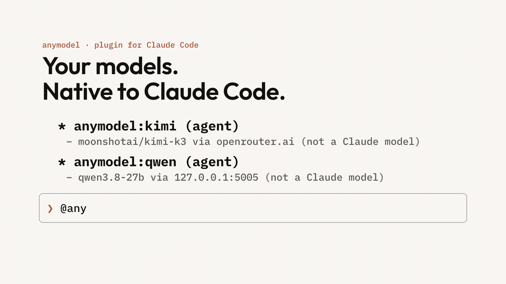
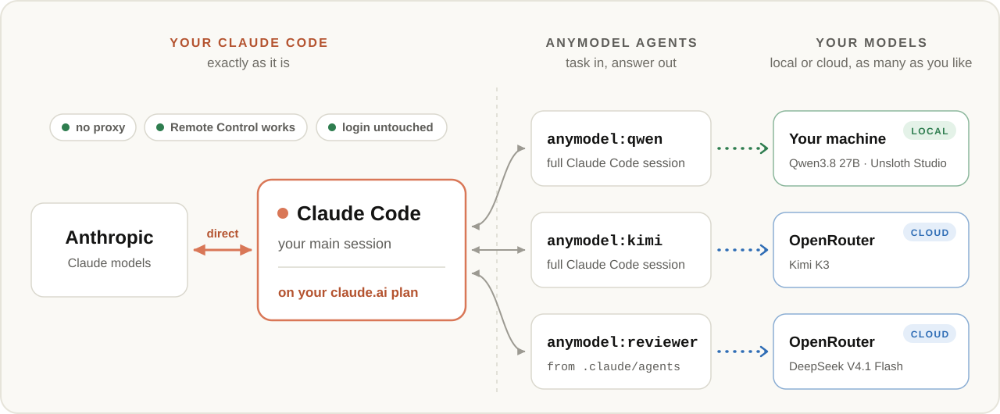

<div align="center">

# anymodel

**Claude Code subagents on the models you choose, local or cloud.**<br>
**Your main session stays on Claude, with no proxy in between.**

[](https://code.claude.com)
[](../../LICENSE)

**[Quick start](#quick-start)** · [Usage](#usage) · [How it works](#how-it-works) · [Comparison](#comparison) · [FAQ](#faq)



</div>

## Why anymodel

Hand tests, searches, reviews and first drafts to another model, and keep Claude for the thinking.

<table>
<tr>
<td width="50%" valign="top">

###  Remote Control keeps working

**No proxy, no gateway, no patched Claude Code.**<br>
Claude Code turns Remote Control off when its base URL points elsewhere. anymodel never touches it.

</td>
<td width="50%" valign="top">

###  Your login stays yours

**Nothing reads, stores or forwards it.**<br>
Your subscription works as before. Each agent signs in only to its own provider, with that provider's key.

</td>
</tr>
<tr></tr>
<tr>
<td width="50%" valign="top">

###  Your Claude limits last longer

**Claude writes the task and reads the answer.**<br>
The agent's own turns (reading files, running commands, retrying) run on its model and bill to its provider.

</td>
<td width="50%" valign="top">

###  Run agents on your hardware

**With a local model, every agent step runs on your machine.**<br>
The files it reads and its command output go to that model, not a cloud one. Claude gets the task and the answer.

</td>
</tr>
<tr></tr>
<tr>
<td width="50%" valign="top">

###  Subagents like Claude's own

**Pick, watch, message, stop.**<br>
Each agent is a full Claude Code session with its tools, MCP and the project's `CLAUDE.md`. It shows in the `@`
list and `/tasks`; Esc stops it.

</td>
<td width="50%" valign="top">

###  Your permissions apply

**Same mode, same rules, same sandbox.**<br>
Approvals come to you, by name: *kimi (moonshotai/kimi-k3) wants to use Bash(npm test). Allow it?*

</td>
</tr>
</table>

## Quick start

You need Claude Code 2.1.309 or later (tested on 2.1.309 and 2.1.310) on macOS or Linux, `claude` on your PATH, and
a model that calls tools, served over the Anthropic Messages API (`/v1/messages`).

**1. Install the plugin** in Claude Code:

```text
/plugin marketplace add ph3on1x/agent-plugins-skills
/plugin install anymodel@ph3on1x
```

**2. Add an agent.** Run `/plugin configure anymodel`, fill in one column below and save:

| Field | OpenRouter | Local (Unsloth Studio) |
|---|---|---|
| **Agent name** | `kimi` | `qwen` |
| **Server URL** | `https://openrouter.ai/api` | `http://127.0.0.1:8888` |
| **Model** | `moonshotai/kimi-k3` | the model id the server lists |
| **API key** | `sk-or-...` | the key from Unsloth Studio's settings, or blank for a server with none |
| **Context size** | leave blank | leave blank |

anymodel saves the agent and clears the form for the next one. To change an agent, run `/plugin configure anymodel
<agent>`: the form opens with its settings. `/anymodel remove <agent>` removes one. Load a local model with 65536
tokens of context or more. LM Studio, llama.cpp and vLLM work the same way but are untested so far.
[Settings](REFERENCE.md#settings)

**3. Check it.** `/anymodel check` reads each model's context size and asks the model for a test tool call.
[Troubleshooting](REFERENCE.md#troubleshooting)

**4. Run a task.** `/anymodel kimi review src/auth for missing error handling`, or `qwen` with the local example.

<picture>
  
</picture>

<sub>Real output, recorded on 2026-10-24: three agents checked, then Kimi K3 on OpenRouter at work.</sub>

## Usage

| You type | What happens |
|---|---|
| `/anymodel <agent> <task>` | Runs exactly what you typed, without Claude rewording it first. |
| `@agent-anymodel:<agent> <task>` | Claude writes the task from your conversation, starts the agent and gets its answer. |
| `/anymodel` | Lists your agents with their models and context sizes. |
| `/anymodel check [agent]` | Reads each context size and asks for a test tool call. |
| `/plugin configure anymodel <agent>` | Opens the settings form holding the agent's settings, to change them. |
| `/anymodel remove <agent>` | Removes the agent, and its server's key once no agent uses that server. |
| `/anymodel cleanup [days]` | Removes old agent session records and transcripts. |

**Give it a self-contained task.** The agent sees its task, not your conversation.

### Custom agents

Give an agent a specialty: save a Claude Code agent file as `.claude/agents/reviewer.md`,

```markdown
---
name: reviewer
description: Reviews code for security problems. Use after changes to auth or input handling.
tools: Read, Grep, Glob
model: anymodel
---
You are a security reviewer. Report each problem with its file and line, most severe first.
```

then add an agent named `reviewer` in `/plugin configure anymodel`, for example `moonshotai/kimi-k3` on
`https://openrouter.ai/api`. Claude now picks `reviewer` by its description and runs it on Kimi, with your prompt and
tools. `model: anymodel` makes it fail instead of running on Claude if the plugin is ever off.
[More on custom agents](REFERENCE.md#custom-agents)

## How it works

Each agent runs as a separate Claude Code session pointed at its own provider. The plugin registers it in your main
session as a subagent and hands its answer back to Claude. Your main session keeps its login and its connection to
Anthropic.

<picture>
  <source media="(prefers-color-scheme: dark)" srcset="assets/hero-dark.svg">
  
</picture>

| To | What |
|---|---|
| **The agent's provider** | The agent's prompts, the files it reads, its command output and its own auto-mode checks. With a local model, that is your machine. |
| **Anthropic** | The task Claude writes and the agent's answer, Claude Code's progress summary of a long-running agent and, in auto mode, its check of the answer. |

**Reports reach Claude.** Ask the agent for a summary when the code itself should not.
API keys stay in Claude Code's secure storage and go only to their own server.
[What goes where](REFERENCE.md#what-goes-where) · [Security](REFERENCE.md#security)

## Comparison

As of October 2026, from each project's docs and source. We did not run them; some behaviour is inferred from their
design.

| | **anymodel** | Proxy routers ¹ | pi ² | CLI bridges ³ |
|---|:-:|:-:|:-:|:-:|
| **Claude untouched, Remote Control works** | **Yes** | No | Yes | Yes |
| **Claude Code tools, MCP, project `CLAUDE.md`** | **Yes** ⁴ | Yes | No | No |
| **Your permission mode and prompts** | **Yes** | Yes | No | No |
| **Native subagent controls** ⁵ | **Yes** | Partly | Partly | Partly |
| **Claude Code agent files on another model** | **Yes** | Partly | No | No |
| **Any model per call, no agent set up** | No | Partly | Yes | Partly |
| **Claude Code's tool cards** | No, notices | Yes | No | No |
| **OpenAI-only servers** | Via a proxy or OpenRouter | Partly | Yes | Partly |

¹ [model-relay](https://github.com/cablate/model-relay), [claude-code-router](https://github.com/musistudio/claude-code-router)
and [cameo](https://github.com/aisk/cameo) put a gateway or proxy in front of your Claude Code session;
[cc-subagent-models](https://github.com/TejasLamba2006/cc-subagent-models) patches Claude Code and needs one.<br>
² [pi-agent-for-claude](https://github.com/FazalAAli/pi-agent-for-claude) runs its subagent in the pi CLI.<br>
³ [codex-plugin-cc](https://github.com/openai/codex-plugin-cc), [PAL MCP](https://github.com/BeehiveInnovations/pal-mcp-server)
and similar hand the task to another tool, which runs with its own permissions.<br>
⁴ No WebSearch. Only your user and project MCP servers, without OAuth logins. Your personal `CLAUDE.md`, hooks,
plugins and skills do not load. [Limits](REFERENCE.md#limits)<br>
⁵ The `@` list, `/tasks`, messages mid-task and Esc.

## FAQ

<details>
<summary><b>Does it touch my claude.ai login or my setup?</b></summary>

No. Your main session talks to Anthropic exactly as before. Each agent is a separate Claude Code process with its own
config directory, signed in only to its provider with that provider's key. Anthropic's
[terms](https://code.claude.com/docs/en/legal-and-compliance) say "developers may not collect, store, or intermediate
Claude.ai credentials or session tokens"; anymodel does none of that.
</details>

<details>
<summary><b>What does it cost? Does it use my Claude plan?</b></summary>

The provider bills the agent's own turns; a local model has no API bill. Your Claude plan covers the task Claude
writes, the answer it reads and Claude Code's progress summary of a long-running agent. `/anymodel <agent> <task>`
skips the first.
</details>

<details>
<summary><b>Which models work?</b></summary>

Models that call tools reliably, on a server that speaks the Anthropic Messages API. Tested on 2026-10-24: a local
Qwen3.8 27B fine-tune on Unsloth Studio, and on OpenRouter Kimi K3, DeepSeek V4.1 Flash, GLM 5.3, Qwen3.8 27B,
MiniMax M3.1 Flash, Gemini 3.8 Flash and GPT-5.6 Luna. `/anymodel check` tells you whether yours can.
</details>

<details>
<summary><b>My server speaks only OpenAI's API. Can I use it?</b></summary>

Put a translating proxy such as LiteLLM in front of that server only, or reach the model through OpenRouter. Your
Claude session stays untouched either way.
</details>

<details>
<summary><b>Is a local model fast enough?</b></summary>

Its first request reads about 13k tokens of Claude Code's instructions and tool definitions; later requests can reuse
the server's prompt cache. Load the model with 65536 tokens of context or more, and give small models short, concrete
tasks.
</details>

<details>
<summary><b>Is it safe to let another model run commands?</b></summary>

Your permission mode, rules and sandbox apply, and approvals come to you. In `auto` mode the agent's own model
approves its tool calls, and `bypassPermissions` allows everything: use those two only with models you trust with your
shell. A custom agent with `tools: Read, Grep, Glob` stays read-only. [Permissions](REFERENCE.md#permissions)
</details>

<details>
<summary><b>Will it keep working when Claude Code updates?</b></summary>

anymodel relies on Claude Code behaviour that its docs do not promise. It is tested on 2.1.309 and 2.1.310, and
`/anymodel check` shows quickly whether an agent still works. [Test suite](test/README.md)
</details>

<details>
<summary><b>What can't an agent do?</b></summary>

Its progress shows as notices, not Claude Code's tool cards ([requested](https://github.com/anthropics/claude-code/issues/104824)).
It has no WebSearch and cannot keep a command running in the background. Your personal `CLAUDE.md`, hooks, plugins and
skills do not load in it; the project's do. [All limits](REFERENCE.md#limits)
</details>

---

<div align="center">

[Reference](REFERENCE.md) · [Test suite](test/README.md) · [MIT license](../../LICENSE)

</div>
