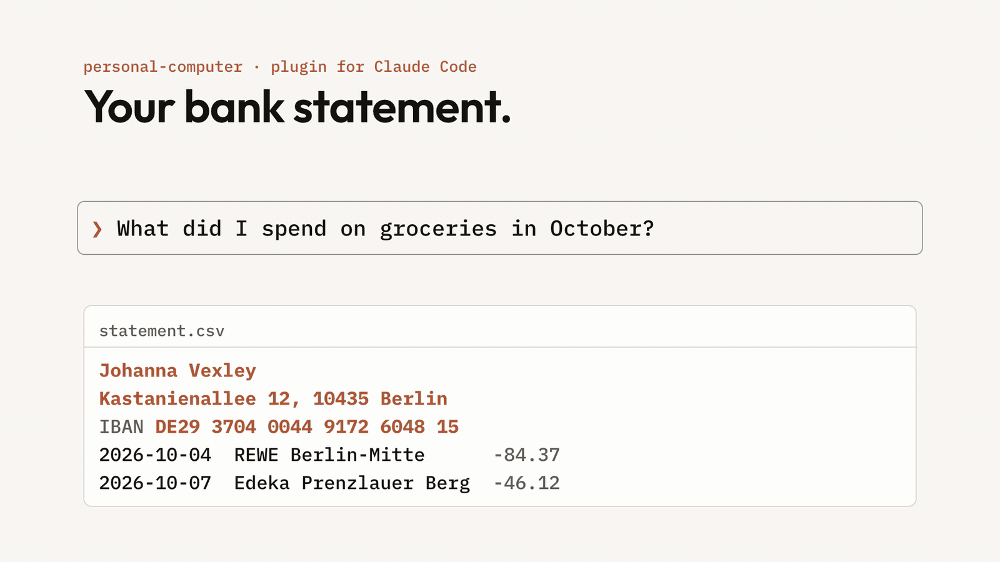
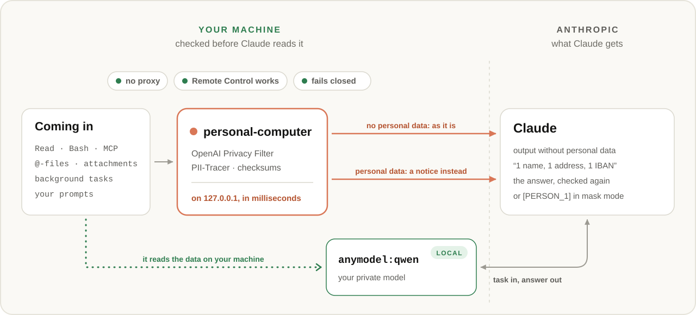

<div align="center">

# personal-computer

**Personal data is checked on your machine before Claude reads it.**<br>
**Claude still does the work, with a private model you run.**

[](https://code.claude.com)
[](REFERENCE.md#requirements)
[](../../LICENSE)

**[Quick start](#quick-start)** · [Usage](#usage) · [How it works](#how-it-works) · [Comparison](#comparison) · [FAQ](#faq)



</div>

## Why personal-computer

Ask Claude about your bank statement, your contracts or your customer list, and keep the data on your machine.

<table>
<tr>
<td width="50%" valign="top">

###  Checked before Claude reads it

**Every tool output, on your machine.**<br>
Two local models, OpenAI Privacy Filter and PII-Tracer, and IBAN and card checksums find names, addresses, phone
numbers, account numbers and secrets in milliseconds.

</td>
<td width="50%" valign="top">

###  Claude still gets it done

**It hands that part to your private model.**<br>
Claude gets a notice of what was found, never a value, and asks your [anymodel](../anymodel) agent, which reads the
data on your machine. Its answer is checked again before Claude reads it.

</td>
</tr>
<tr></tr>
<tr>
<td width="50%" valign="top">

###  Or mask it

**Placeholders for Claude, real values in your files.**<br>
Claude reads `[PERSON_1]` and `[IBAN_1]`. The letter it writes names the person.

</td>
<td width="50%" valign="top">

###  Everything coming in

**Tool output, @-files, background tasks, your prompts.**<br>
Files Claude Code attaches by itself and your subagents' work are checked the same way. Your prompts too, with a
question first.

</td>
</tr>
<tr></tr>
<tr>
<td width="50%" valign="top">

###  Fails closed

**If it can't check, Claude doesn't get it.**<br>
A warning line says so until a check works again. Off until you set it up; once on, in every session.

</td>
<td width="50%" valign="top">

###  Claude Code untouched

**No proxy, no gateway.**<br>
It runs inside Claude Code as a mod. Your login, your plan and Remote Control work as before.

</td>
</tr>
</table>

## Quick start

You need Claude Code 2.1.310 or later (tested on 2.1.310), a Mac with Apple silicon (the checks run on MLX),
[uv](https://docs.astral.sh/uv/), and 3.7 GB of disk for the two detection models.

**1. Install the plugin** in Claude Code. [anymodel](../anymodel) installs with it:

```text
/plugin marketplace add ph3on1x/agent-plugins-skills
/plugin install personal-computer@ph3on1x
```

**2. Add a private agent.** Run `/plugin configure anymodel` and add an agent on a model you trust with your data: a
local one, for example `qwen` on Unsloth Studio at `http://127.0.0.1:8888`, or one on your own server.
[anymodel's quick start](../anymodel#quick-start)

**3. Turn it on.** Run `/personal-computer`, pick **Private agent** `qwen` in its pane, and press **Set up** (`s`).
Setup downloads the detection models from Hugging Face, starts the scanner and checks that it finds the name and IBAN
in a test text. Then it is on, and the footer shows **personal computer** beside Claude Code's own modes.

**4. Ask as you would.** "What did I spend on groceries in October? My bank statement is in ~/Downloads."

<picture>
  
</picture>

<sub>Real output, recorded on 2026-10-26: the check, then a statement withheld from Claude and its total from Qwen
on Unsloth Studio.</sub>

## Usage

| You type | What happens |
|---|---|
| `/personal-computer` | Opens its pane: how it stands, its settings, **Set up** and **Check again**. |
| `/personal-computer check` | Prints the same check, where no pane can be shown (`claude -p`). |
| `/personal-computer setup` | Downloads the models, starts the scanner and runs its self-test. |
| `/personal-computer cleanup [days]` | Removes what it keeps on your machine, older than Claude Code's `cleanupPeriodDays`. |
| `/plugin configure personal-computer` | The same settings as the pane. |

**When personal data is found** (`mode`):

| Mode | Claude gets |
|---|---|
| `private` (default) | A notice of what was found, by type and count, never a value. Claude asks your private agent, which reads the output from a local copy or the file itself. |
| `mask` | The output with each value replaced by a placeholder: `[PERSON_1]`, `[IBAN_1]`. Files Claude writes get the real values back. |
| `ask` | Your choice each time: process privately, mask, share as is or leave out. With no one to ask (`claude -p`), it stays private. |

**Your prompts** (`prompts`) are checked before they reach Claude, pasted text included. With `ask` (default), a
prompt with personal data asks you: mask it, send it as is, or cancel. `mask` masks without asking; `off` leaves
prompts unchecked. [Settings](REFERENCE.md#settings)

## How it works

Every output reaches the plugin before Claude reads it: in your main session, in subagents, and in what Claude Code
attaches by itself. A scanner on 127.0.0.1 runs two models on it, and checksums for IBANs and card numbers. Output
without personal data goes on as it is. Output with personal data is withheld, and Claude hands that part of the task
to your private model.

<picture>
  <source media="(prefers-color-scheme: dark)" srcset="assets/hero-dark.svg">
  
</picture>

| To | What |
|---|---|
| **Your private model** | The task Claude writes. It reads the data itself, on your machine or your own server. |
| **Anthropic** | Output without personal data, the notices (types and counts), your private model's answer (masked if it holds personal data), and in `mask` mode the output with placeholders. |

**Detection is statistical.** A model can miss a value or flag a word that is none; the defaults favour finding.
[What is checked](REFERENCE.md#what-is-checked) · [Limits](REFERENCE.md#limits) · [Security](REFERENCE.md#security)

## Comparison

As of October 2026, from each project's docs and source. We did not run them; some behaviour is inferred from their
design.

| | **personal-computer** | Redaction hooks ¹ | PII gateways ² | MCP redaction ³ | All-local agent ⁴ |
|---|:-:|:-:|:-:|:-:|:-:|
| **Checks tool output before Claude reads it** | **Yes** | Partly | Yes ⁵ | Their own tools | No Claude |
| **Finds names and addresses, not only patterns** | **Yes**, two models | No, regex | Yes | Partly | — |
| **Claude still finishes the task with the data** | **Yes**, via your private model | No | Partly | Partly | No Claude |
| **Claude Code untouched, Remote Control works** | **Yes** | Yes | No | Yes | No |
| **Real values back in files Claude writes** | **Yes**, `mask` mode | Partly | Partly | Partly | — |
| **Subagent answers and notifications checked** | **Yes** | Partly | Yes ⁵ | No | — |
| **Any OS** | No, Mac with Apple silicon | Yes | Yes | Yes | Yes |

¹ [claude-code-redaction-hooks](https://github.com/l-mb/claude-code-redaction-hooks),
[claude-code-redact](https://github.com/karanb192/claude-code-redact) and
[pii-guard](https://github.com/dave-net-positive/Claude_Code_PII_Redactor): regular expressions and checksums in
Claude Code hooks or mods. claude-code-redact restores values in file edits.<br>
² [LiteLLM with Presidio](https://docs.litellm.ai/docs/proxy/guardrails/pii_masking_v2),
[PasteGuard](https://github.com/sgasser/pasteguard) and [Portkey](https://portkey.ai/docs/integrations/libraries/claude-code)
sit at `ANTHROPIC_BASE_URL`, which [turns Remote Control off](https://code.claude.com/docs/en/remote-control).
PasteGuard can send a request with personal data to a local model instead of Claude.<br>
³ [redact-mcp](https://github.com/r3352/redact-mcp) and [MCP Conceal](https://github.com/gbrigandi/mcp-server-conceal)
redact what their own tools return; Claude Code's built-in tools are not filtered.<br>
⁴ Claude Code pointed at [Ollama](https://docs.ollama.com/integrations/claude-code),
[LM Studio](https://lmstudio.ai/docs/integrations/claude-code) or
[Claude Code Router](https://github.com/musistudio/claude-code-router): nothing reaches a cloud model, and Claude
does none of the work.<br>
⁵ Of the whole request, by their docs; they do not say how tool results are handled.

## FAQ

<details>
<summary><b>Does Claude ever see my personal data?</b></summary>

Not what the models find: in `private` mode Claude gets "1 name, 1 address, 1 IBAN", and in `mask` mode
`[PERSON_1]`. It sees what they miss, what you choose to share in `ask` mode, and the files you open in your editor.
Detection is statistical; your own name and email (from git and your Mac account) are never counted.
[What is checked](REFERENCE.md#what-is-checked)
</details>

<details>
<summary><b>Do I need a local model?</b></summary>

Your private agent needs a model you trust with the data: one on your machine, or one on your own server, where the
data then goes. `mask` mode needs no private agent at all. `/personal-computer check` names the agent and whether it
runs on this machine.
</details>

<details>
<summary><b>Does it slow Claude Code down?</b></summary>

A short output takes tens of milliseconds. The first check after a start waits for the models to load. One scanner
serves all your sessions; it listens on 127.0.0.1 only and exits after 30 minutes without a
request.
</details>

<details>
<summary><b>What happens when it can't check?</b></summary>

Once on, anything it cannot check is withheld, and a warning line under the prompt says so until a check works
again: `⚠ personal-computer: can't check for personal data, so outputs are withheld · /personal-computer`. A prompt
it cannot check asks whether to send it unchecked (with `prompts` set to `ask`); otherwise it is not sent.
</details>

<details>
<summary><b>What does it keep on my machine?</b></summary>

Withheld outputs, masked answers and each session's placeholders, in `~/.local/state/personal-computer/withheld`,
readable by you only. They go with Claude Code's own transcripts after `cleanupPeriodDays` (30 days by default);
`/personal-computer cleanup [days]` removes them sooner.
</details>

<details>
<summary><b>What if I uninstall anymodel?</b></summary>

personal-computer needs it: Claude Code warns `required by personal-computer` and uninstalls it anyway. From then
on it does not load personal-computer, and outputs are no longer checked: `claude plugin list` shows `✘ failed to
load`. Install anymodel again to turn it back on.
</details>

<details>
<summary><b>Does it work in the desktop app, VS Code, Remote Control and claude -p?</b></summary>

The checks run wherever the session runs. The pane and the footer label show in the terminal and the desktop app,
VS Code shows the pane, and the warning line shows everywhere. Remote Control mirrors your screen to claude.ai, so
what the screen shows, such as a file Claude wrote in `mask` mode, leaves the machine. In `claude -p`, use
`/personal-computer check` and `/personal-computer setup`.
</details>

<details>
<summary><b>Will it keep working when Claude Code updates?</b></summary>

It runs on Claude Code's mods API and is tested on 2.1.310. `/personal-computer check` shows quickly whether it still
works. [Test suite](test/README.md)
</details>

---

<div align="center">

[Reference](REFERENCE.md) · [Test suite](test/README.md) · [MIT license](../../LICENSE)

</div>
